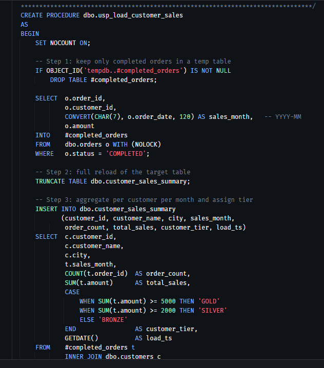
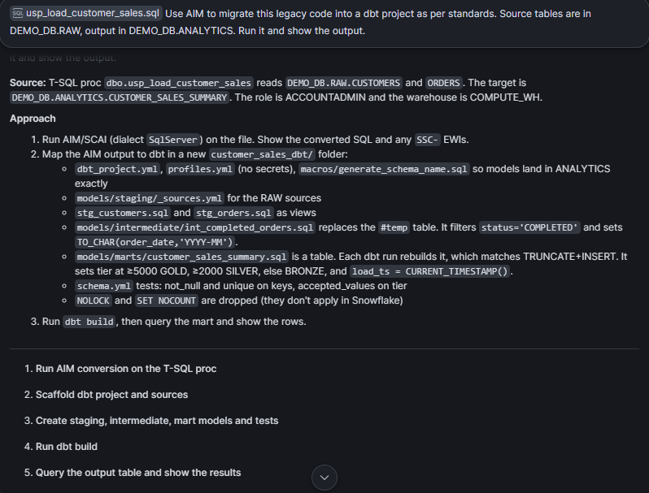
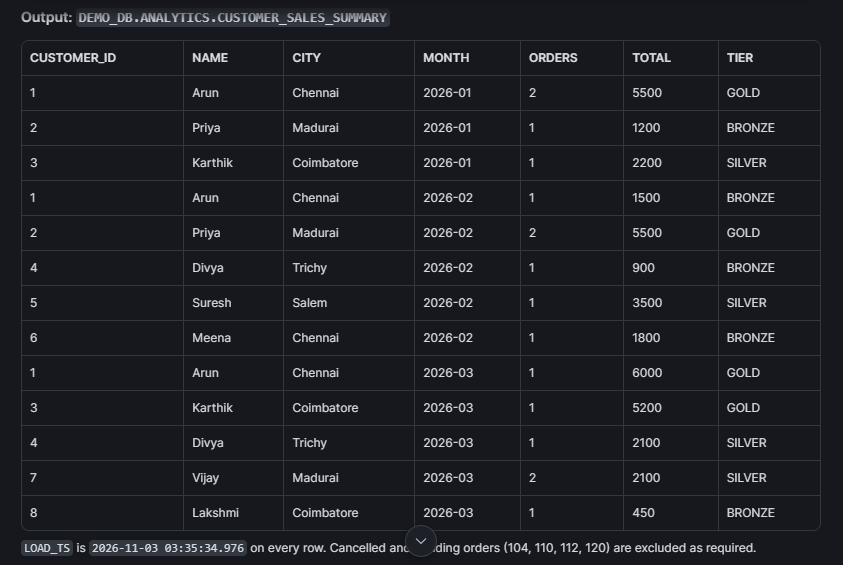
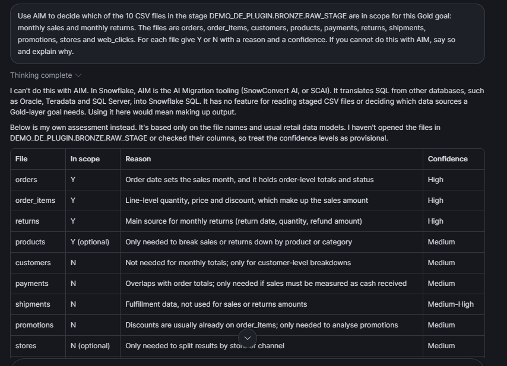

# Snowflake AIM vs Foundry and the DE Plugin

**Prepared:** 2026-11-02. Updated 2026-11-05. This is a proposal for discussion, not a decision.
**Basis:** official Snowflake documentation only (sources are listed at the end), plus our own Cortex Code tests on our trial account (Section 1) and a colleague's Informatica-to-dbt POC (Section 3).

---

## 1. What AIM did on our trial account

<table>
<tr>
<th width="50%">LEFT: legacy code in, AIM migrated it</th>
<th width="50%">RIGHT: a decision ask, AIM could not do it</th>
</tr>
<tr>
<td valign="top">

**(a)** The legacy SQL Server (T-SQL) code we gave it.

**(b)** Our one-line prompt, and the plan AIM made by itself.

**(c)** The finished output: 13 rows, matching the legacy result.

</td>
<td valign="top">

**(d)** We asked it to decide which files are needed for a business goal. Reply: "I can't do this with AIM."

</td>
</tr>
<tr>
<td valign="top">

**What it shows:** code in, finished output out. No human work was needed in between.

*Honest note:* the test was small (8 customers, 20 orders), and we wrote the legacy code ourselves.

</td>
<td valign="top">

**What it shows:** a decision is not a translation job, so it comes back to the human.

*Honest note:* Cortex Code then gave its own Y/N guess, but it says it used **file names only**. It did not open the files. Our real data check disagreed on payments and customers.

</td>
</tr>
</table>

**In one line:** AIM is very good when there is existing code to convert. When the job is a decision, a human must make it, and that is where our DE plugin stops and asks.

---

## 2. Action Plan

| # | Suggestion | Solution |
|---|---|---|
| 1 | Approval gates can be skipped (orchestrator offers "Skip and continue") | Remove skip for design and load approvals so the pipeline always stops until a human approves. |
| 2 | No test set, only clean static TPCH data profiled | Add a small file-based dataset with planted defects (nulls, duplicates, bad dates); check each run against expected results. |
| 3 | Load checks compare row counts only | Add value-level checks such as sum totals and null rates on key columns. |
| 4 | Bad rows have nowhere to go | Add quarantine tables for rows failing a rule, plus a failure threshold that stops the batch. |
| 5 | Access control comes last (share phase), powerful roles not ruled out | Design roles at schema design stage; never ACCOUNTADMIN or ALL PRIVILEGES; least privilege per role. |
| 6 | PII not protected by default | Add masking policies on PII columns (e.g. customer name, email) at setup stage so only approved roles see unmasked data. |

---

## 3. Cost, and where AIM runs

**Where AIM runs**
- AIM can be driven from **Cortex Code in Snowsight**. Our own test in Section 1 ran this way, and a colleague's Informatica-to-dbt POC was also done with Cortex Code only.
- The Snowflake docs also mention the Cortex Code CLI and the AIM desktop app.

**What the POC cost** (a colleague's results, not our tests)
- 10 Informatica workflows in about 3 hours and **40 credits**.
- Simple workflows about **5 credits** each, medium and complex about **9 credits** each.
- AIM sometimes paused, and someone had to type "Proceed" or "OK" to continue, so the run needed a person watching.

**Cost: no estimate before you run**
- The AIM docs give **no pre-run cost or credit estimate** for an AIM project.
- The Assessment page estimates only the **manual effort** still needed, not credits.
- The SnowConvert Migration Assistant billing page says it is **not possible to precisely estimate** the cost of an interaction. Its only rough figure is about **3,500 tokens (about 0.0089 credits) per EWI fix**, and it can be much more.
- So with AIM, cost is known only **after** the work has run (through usage views and budgets).

**Foundry: cost control is defined**
- The Foundry rulebook (Observability standards) requires **cost per run** to be tracked.
- Snowflake offers **per-user Cortex Code daily credit limits**, which we already use on our trial account to cap spending.
- Note: this is **defined and planned, not built**. Our own summary (Section 7) lists Foundry cost tracking as *Yet to Start* and the DE plugin as *not available*.

---

## 4. Source support: AIM vs Foundry

| Source | AIM (per Snowflake docs) | Foundry (our status) |
|---|---|---|
| SQL Server | ✅ Full: extract, convert, deploy, move data, validate, test | ❌ |
| Redshift | ✅ Full | ❌ |
| Teradata | 🟡 Partial: convert, move data and validate are available; extract and deploy are "Planned" | ❌ |
| Oracle | 🟡 Partial: convert, move data and validate are available; extract and deploy are "Planned" | ❌ |
| PostgreSQL | 🟡 Mostly: AI conversion and testing are "Planned" | ❌ |
| IBM Db2 | 🟡 Convert, move data and validate | ✅ Db2 skill (Pre-Production). ⚠️ Overlap |
| Azure Synapse, BigQuery | 🟡 Convert, move data and validate | ❌ |
| Netezza, Vertica, Sybase IQ, Greenplum, Databricks SQL, Spark SQL | 🟠 Code conversion only | ❌ |
| Hive | 🟠 Code conversion only | ✅ Hadoop skill (Testing) |
| Spark code (Python, Java, Scala) | ✅ Separate agent (AIM for Spark) | ❌ |
| Hadoop (HDFS, files) | ❌ Not in the docs | ✅ Hadoop skill (Testing) |
| SSIS to dbt | ✅ | ❌ |
| Informatica to dbt | ✅ | ❌ |
| SAS | 🟡 Preview | ❌ |
| DataStage to dbt | 🟡 In SnowConvert AI release notes (Sep–Oct 2026), not on the AIM overview page | ✅ Pre-Production. ⚠️ Overlap |
| **SAP (QM)** | ❌ Not in the docs | ✅ Source Analyzer (Development) |

**Legend:** ✅ supported · 🟡 partial · 🟠 code conversion only · ❌ not supported

**In short**
- **Only AIM covers:** SQL Server, Redshift, Teradata, Oracle, PostgreSQL, Synapse, BigQuery, SSIS, Informatica, Spark.
- **Only Foundry covers:** SAP and Hadoop (HDFS).
- **Both cover (overlap):** Db2, Hive and DataStage.

---

## 5. Answering the two questions

### Thinking 1: "Can the DE plugin replace part of AIM?"

**Answer: No.**

- AIM and the DE plugin do different jobs, and the DE plugin starts where AIM ends.
  - **AIM** brings code and data from a source system **into** Snowflake.
  - **The DE plugin** turns data that is already in Snowflake from **Bronze into Gold**.
- The only overlap is **validation**, and there AIM is stronger. AIM checks schema, metrics and row-level hashes, while our plugin checks row counts only.
- So the realistic opportunity is the reverse: **reuse AIM's validation inside the DE plugin**, not replace AIM.

> "The DE plugin does not replace AIM; they work at different stages. If we reuse AIM's validation inside our plugin, the plugin gets stronger."

### Thinking 2: "Whatever AIM does not provide, the DE plugin will provide"

**Answer: Partly true.**

✅ **True part.** Once data is in Snowflake, AIM does nothing more. The DE plugin covers:
- Data profiling and PII discovery
- Building the Gold mart
- Data quality, including quarantining bad rows
- RBAC and masking
- Daily load and scheduling

❌ **Not true part.** The DE plugin cannot help with sources that AIM does not support (SAP, Hadoop), because it does not bring data into Snowflake. That job belongs to **other Foundry skills**: the SAP QM Source Analyzer and the Hadoop skill.

> "The DE plugin handles everything after migration. Bringing data in from sources AIM does not support is the job of Foundry's SAP and Hadoop skills, not the DE plugin."

**In one line:** AIM and the Foundry skills bring the data in, and the DE plugin makes it usable. Neither replaces the other; they work together.

---

## 6. AIM as a tool: AIM vs DE plugin

This section is about **how** AIM works as a tool, compared with our DE plugin. It does not cover **what** AIM migrates.

| Aspect | How AIM works | How the DE plugin works |
|---|---|---|
| Where it runs | Cortex Code CLI or the AIM desktop app, on the user's machine (per docs; a colleague's POC shows output in a Snowsight Workspace, so not confirmed). Data migration and validation run on Snowpark Container Services (SPCS) or on our own servers. | Cortex Code skills |
| How you operate it | Conversational; you can jump to any stage | 7 steps in a strict order, enforced by hooks |
| Saving progress and resuming | Automatic, across sessions | Run log |
| Approval | Interactive review only (review AI fixes, lock the deployment waves). No formal gate before DDL is in the docs. | Human approval required before DDL |
| On failure | Auto fix loop (diagnose → fix → retest). Tasks can be retried, paused or skipped. | Stops at quality gates |
| Validation | L1 schema, L2 metrics, L3 row hash | Row count only |
| Cost | Cortex Code credits plus warehouse or SPCS compute. AIM pricing is not in the docs, and there is **no pre-run estimate in the docs**. | Cortex Code credits plus warehouse. Capped by per-user Cortex Code daily credit limits; cost per run is defined in the Foundry rulebook but not built yet. |
| Source analyzer | Analyzes **code** (complexity, deployment waves) | Analyzes **data** (PII, keys) |

**In one line:** AIM is a flexible, conversational migration tool. Our plugin is a strict, gated build tool.

---

## 7. Final summary: features across AIM, Foundry and the DE plugin

**Columns**
- **AIM:** only what the Snowflake docs state.
- **Foundry:** Foundry skills other than the DE plugin.
- **DE plugin:** our 7 steps.

**Legend:** ✅ available · 🟡 partial or in progress · ❌ not available · ❓ no information yet (the team needs to confirm)

### A. Migration (bringing data in)

| Feature | AIM | Foundry | DE plugin |
|---|---|---|---|
| Source code assessment | ✅ | 🟡 Assessment phase | ❌ |
| Code extraction from source | ✅ | 🟡 | ❌ |
| SQL code conversion | ✅ | 🟡 Db2 (Pre-Production), Hadoop (Testing) | ❌ |
| ETL to dbt (SSIS, Informatica) | ✅ | ❌ | ❌ |
| DataStage to dbt | 🟡 In release notes | 🟡 Pre-Production | ❌ |
| SAP source analysis | ❌ | 🟡 Development | ❌ |
| Data migration (source to Snowflake) | ✅ | 🟡 Hadoop (Testing) | ❌ |
| Incremental load (watermark) | ✅ | ❓ | ❓ |

### B. Data understanding and design

| Feature | AIM | Foundry | DE plugin |
|---|---|---|---|
| Data profiling | ❌ | ❌ | ✅ |
| PII and key detection | ❌ | ❌ | ✅ |
| Staging and Gold schema design | ❌ (converts source DDL as-is) | ❌ | ✅ |
| DDL deploy | ✅ In waves | ❌ | ✅ |

### C. Load, quality and validation

| Feature | AIM | Foundry | DE plugin |
|---|---|---|---|
| Load to staging | ✅ | ❌ | ✅ |
| Quarantine bad rows | ❌ | ❌ | ✅ |
| Row count check | ✅ | ❌ | ✅ |
| Schema, metrics and row-hash validation (L1–L3) | ✅ | ❌ | ❌ |
| Data quality agent | ❌ | 🟡 Verity (Testing) | 🟡 Quarantine only |

### D. Gold, governance and operations

| Feature | AIM | Foundry | DE plugin |
|---|---|---|---|
| Gold transform (Dynamic Table) | ❌ | ❌ | ✅ |
| RBAC (roles, grants) | ❌ | ❌ | ✅ |
| Masking | ❌ | ❌ | ✅ |
| Daily schedule (Tasks) | ❌ | ❌ | ❌ Known gap |
| Monitoring and alerts | 🟡 During migration only | 🟡 Observability phase | 🟡 Run log and alert |
| Cost estimate before running | ❌ Not in the docs | ❌ | ❌ |
| Cost tracking | ❌ After the fact only (Snowflake has separate Cortex Code budgets and usage views) | 🟡 Cost per run defined in rulebook; Yet to Start | ❌ (per-user daily credit limit only) |
| Data sharing | ❌ | 🟡 Phase defined only | ❌ (de-share is governance) |

### E. Tool behaviour

| Feature | AIM | Foundry | DE plugin |
|---|---|---|---|
| Works without existing source code (e.g. files in a stage) | ❌ Needs a source platform and code (Cortex Code answer, 2026-11-02; not hands-on) | ❓ | ✅ |
| Human approval before DDL | 🟡 Review only, no formal gate | ❓ | ✅ |
| Enforced step order (hooks) | ❌ Can jump to any stage | ❓ | ✅ |
| Auto fix loop on failure | ✅ | ❓ | ❓ |
| Resume across sessions | ✅ | ❓ | 🟡 Run log |
| Multiple users on one project | ✅ | ❓ | ❓ |
| Git review, evaluate, promote | ❌ Not in the docs | ✅ | ✅ |
| Works without ACCOUNTADMIN | ❓ Not in the docs | ❓ | ❌ Needs ACCOUNTADMIN |

### Summary

- **Only AIM has:** full migration for supported sources, ETL-to-dbt code generation, L1–L3 validation, and the auto fix loop.
- **Only the DE plugin has:** profiling, PII detection, Gold design and build, quarantine, RBAC, masking, and approval gates.
- **Only Foundry has:** SAP and Hadoop (HDFS) source coverage.
- **No one has yet:** daily scheduling, a cost estimate before running, built cost tracking, and true data sharing.
- **Overall:** AIM and Foundry bring data into Snowflake, and the DE plugin turns it into governed Gold data. They work together; none replaces another.

---

*Sources:*
- [AIM overview](https://docs.snowflake.com/en/migrations/aim-for-datawarehouses/overview)
- [Snowflake AIM](https://docs.snowflake.com/en/migrations/snowflake-aim)
- [AIM data migration](https://docs.snowflake.com/en/migrations/aim-for-datawarehouses/data-migration-validation/data-migration)
- [AIM data validation](https://docs.snowflake.com/en/migrations/aim-for-datawarehouses/data-migration-validation/data-validation)
- [AIM troubleshooting](https://docs.snowflake.com/en/migrations/aim-for-datawarehouses/troubleshooting)
- [Cortex Code cost controls](https://docs.snowflake.com/en/user-guide/cortex-code/cost-controls)
- [SnowConvert AI release notes](https://docs.snowflake.com/en/migrations/snowconvert-docs/general/release-notes/release-notes/README)
- SnowConvert Migration Assistant billing page (docs.snowflake.com, SnowConvert docs section)
- Foundry rulebook: Observability standards (cost per run)
- Cortex Code check on our trial account, 2026-11-02 (asked to start AIM on a CSV stage)
- Colleague's Informatica-to-dbt Conversion Assessment using Snowflake AIM (internal POC)
