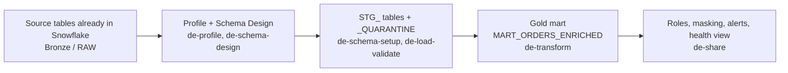
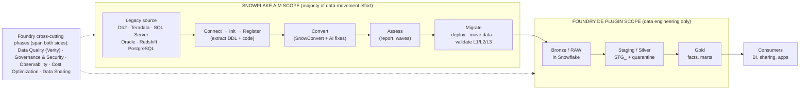

# Foundry DE Plugin: Scope and Snowflake AIM Boundary

Draft for the 30 Oct 2026 review · DE Workflow Plugin · Prepared 29 Oct 2026

> **Intent:** show where the DE plugin sits in Foundry, what Revanth built, and why Snowflake AIM and the plugin are sequential steps, not alternatives.
> AIM facts come only from docs.snowflake.com. Items marked **ASSUMPTION** are my inference and need checking. No pricing figures are used.

---

## 1. Foundry scope

**10 phases** (announced 22 Oct 2026):

1. Assessment & Discovery
2. Source & Target Analysis
3. Data Quality
4. Governance & Security
5. Conversion Factory
6. Data Engineering
7. Observability
8. Cost Optimization
9. Platform Engineering
10. Data Sharing & Consumption

Phases with no capability yet are done manually today.

**7 capabilities** (status unchanged since 22 Oct 2026):

| # | Name | Phase | Type | Status | What it does |
|---|------|-------|------|--------|--------------|
| 1 | Db2 → Snowflake | Conversion Factory | Skill | Pre Production | Converts Db2 DDL, procedures and scripts to Snowflake SQL; flags items that need manual review. |
| 2 | DataStage → dbt | Conversion Factory | Skill | Pre Production | Converts DataStage jobs to dbt projects (SCD, reject handling, lineage). |
| 3 | Source Analyzer (SAP QM) | Source & Target Analysis | Skill | Development In Progress | Inventories SAP QM data in Bronze; produces Silver design and gap analysis. |
| 4 | Verity (DQ control plane) | Data Quality | Agent | Testing In Progress | Runs deterministic quality checks; calls one of 3 Cortex Agents only on a typed outcome. |
| 5 | Hadoop → Snowflake | Conversion Factory | Skill | Testing In Progress | Converts PySpark/Hive to Snowpark (SMA path) with post-conversion fixes. |
| 6 | AI Consumption Tracker | Cost Optimization | Skill | Yet to Start | Cortex Agent budgets, per-user CoCo credit limits, per-model token breakdown. |
| **7** | **⭐ Data Engineering Workflow Migration Plugin** | **Conversion Factory** | **Plugin** | **Yet to Start** | **7 phases (Profile → Schema Design → Schema Setup → Transform Setup → Load & Validate → Transform → Share) with quality gates between them. Owned by me.** |

Note: the plugin is listed under Conversion Factory, but its work (Bronze → Staging → Gold) is functionally the Data Engineering phase. **ASSUMPTION**

---

## 2. The 7 skills Revanth built (v0.1)

Test run: `TPCH_SF10` sample data → `SANDBOX.TPCH`.

| # | Skill | What it does | Output |
|---|-------|--------------|--------|
| 1 | `de-profile` | Profiles every column: type, nulls, distinct, min/max, PII candidates. Read-only, sampled on big tables. | `profile_report.md` |
| 2 | `de-schema-design` | Target types, audit columns, clustering, staging + mart design. Stops for engineer approval. | `schema_design.md` |
| 3 | `de-schema-setup` | Creates empty STG and quarantine tables, masking policies, lineage tag, MONITORING schema. | `schema_setup.sql` |
| 4 | `de-transform-setup` | Column mapping blueprint from source to target. | `transform_mappings.yml` |
| 5 | `de-load-validate` | Loads staging (INSERT…SELECT on TPCH), quarantine, null checks, per-table quality alert. | Loaded rows + alert |
| 6 | `de-transform` | Builds the Gold mart `MART_ORDERS_ENRICHED` (Dynamic Table, one row per order). | Mart table |
| 7 | `de-share` | 3 roles, masking, email integration, 4 alerts, resource monitor, health view. | `governance_report.md` |
| + | `de-workflow` (orchestrator) | Runs phases 1→7 in order with gates 1–7; supports start-from / resume. | `pipeline_summary.md` |
| + | Hooks (`plugin.json`, `hooks.json`, `pipeline-state.sh`) | State machine that checks phase order and that `client-context.md` was read before writing. | Pipeline state file |

**DE plugin scope: Bronze → Gold**



```
 Bronze / RAW            Staging (Silver)              Gold                 Consumers
 (in Snowflake)   ──►   8 STG_ tables         ──►   MART_ORDERS_ENRICHED ──► roles, masking,
 profile + design       + 3 _QUARANTINE tables      (Dynamic Table)          alerts, health view
```

---

## 3. 30-second script

> "AIM and our DE plugin are not competing. AIM moves an existing database and its code into Snowflake and proves the data matches. Our plugin starts after that: it builds new Silver and Gold pipelines where we own the logic, to Foundry standards. Both use Cortex Code credits, so neither is free. To keep cost down, the plugin should use the agent only at design time and run daily loads with Snowflake Tasks. I would like two days on one real use case to measure credits and decide what we keep, adopt from AIM, or drop."

---

## 4. Flow picture: legacy to Gold, and who covers what



Plain-text version (renders anywhere):

```
|<------------------- SNOWFLAKE AIM SCOPE ------------------->|<-------- FOUNDRY DE PLUGIN SCOPE -------->|
|        (majority of the data-movement effort)               |          (data engineering only)          |
|                                                              |                                           |
 LEGACY SOURCE  ──► Connect ─► Init ─► Register ─► Convert ─► Assess ─► Migrate ──► BRONZE/RAW ──► STAGING/SILVER ──► GOLD ──► CONSUMERS
 Db2, Teradata,     (connect    (project  (extract    (Snow-     (report,  (deploy,     in            STG_ tables +       facts,    BI, sharing,
 SQL Server,        to source)  setup)    DDL+code)   Convert    waves)    move data,   Snowflake     quarantine          marts     apps
 Oracle, Redshift…                                    + AI fix)            validate                                       
                                                                           L1/L2/L3)
|<============ Foundry cross-cutting: Data Quality (Verity) · Governance · Observability · Cost · Sharing ============>|
```

**What the official AIM docs say** ([AIM for data warehouses overview](https://docs.snowflake.com/en/migrations/aim-for-datawarehouses/overview)):

- Stages: **Connect, Init, Register, Convert, Assess, Migrate**.
- AIM always starts from the source side.
- Its "midway entry" only skips extraction/conversion when the source code is already converted (SQL Server, Redshift).
- No documented mode to start from data already in Snowflake, and no Gold/mart building.

> **Takeaway:** AIM = legacy to Snowflake. DE plugin = Bronze to Gold. They are **sequential, not alternatives.**

---

## 5. Remaining points (from the justification note, condensed)

### 5.1 Cost

- AIM Agent is itself a skill tree bundled with Cortex Code (CoCo), so CoCo credits apply to both, plus warehouse compute for loading and validation on both sides.
- The real cost driver is **how often an agent runs**. Today the plugin's agent runs every step, including the load.
- Neither can be called cheaper yet: AIM docs give no cost figures. Proposal: measure credits on one use case, tagged by query tag, CoCo and warehouse separately.

### 5.2 Which one to use

| Source | Who owns the logic | Standards needed | Use |
|--------|--------------------|------------------|-----|
| Database on AIM's list (SQL Server, Redshift; Oracle, Teradata, PostgreSQL partly; Db2) | Client's existing code, kept as is | Prove target matches source | AIM |
| Same database | We redesign marts or add new logic | Foundry naming, quality gates, roles | AIM to Bronze, then plugin |
| Client files (our current case) | We build the logic | Foundry standards, daily runs | Plugin **ASSUMPTION** |
| Data already in Snowflake | New mart or data product | Foundry standards | Plugin |
| SSIS / Informatica jobs | Existing ETL | Same output as before | AIM |
| SAP, DataStage (not in AIM docs) | Varies | Foundry standards | Foundry skills + plugin |

Overlap: for migrated logic, AIM's converted procedures and dbt models already build Gold. There the plugin adds nothing and should stay out.

### 5.3 What the plugin should adopt from AIM

- Validation levels: L1 schema, L2 column metrics with tolerance, optional L3 row hash.
- An early-stop rule so a bad load actually fails.
- Per-table load strategy: full, watermark, checksum, full-replace (today only full reload).
- One run id on every step, query and alert.
- Re-run one failed table, not the whole pipeline.
- Progress state in a Snowflake table, readable by the team.
- Use AIM's Assess report for any database source instead of building our own.

### 5.4 Where the plugin is weak today (confirmed from the 7-skill code review)

| Area | Current state |
|------|---------------|
| Daily load | **No Task or Procedure.** The load only runs when the agent invokes the skill (INSERT…SELECT on the TPCH path). |
| Scheduling | The **only auto-running item is the quality alert** (5-minute schedule). |
| Dynamic Tables | **No skill explicitly creates them**; it relies on CoCo interpreting config / AGENTS.md. |
| Mart refresh | `TARGET_LAG = 'downstream'` on the top-level mart, so it **will not auto-refresh** (nothing is downstream of it). |
| Validation | Cannot fail on the current load path, so quarantine always shows 0. |
| Safety | Hooks fail open; no SQL hook. Safety rules are instructions only. |
| Testing | End-to-end testing still pending; ran once on clean TPCH sample data. |
| Hygiene | Needs the top admin role; two copies of each skill. |

**"Design-time-only agent use" is the target, not the current state.** Today the agent is needed at run time too.

### 5.5 Proposed next step

A two-day fit-gap on one real use case:

- **Day 1:** run the plugin on the real files; record what works, what breaks, and credits used.
- **Day 2:** check whether AIM covers any part (data move or validation); write a one-page keep / adopt / drop list with credit numbers.

This also feeds the E2E testing Balaji already asked for.

### 5.6 Open questions

1. Was AIM considered when the plugin was scoped? (AIM announced June 2026; plugin listed "Yet to Start" on 22 Oct 2026.)
2. What is the source type for the real use case: files only, or also a database?
3. Is AIM enabled on our accounts and on client accounts?

---

*Sources: Foundry announcement (22 Oct 2026); Revanth's design doc, skills and run outputs; earlier outsider review and AIM vs Foundry gap map; AIM facts from docs.snowflake.com only.*
